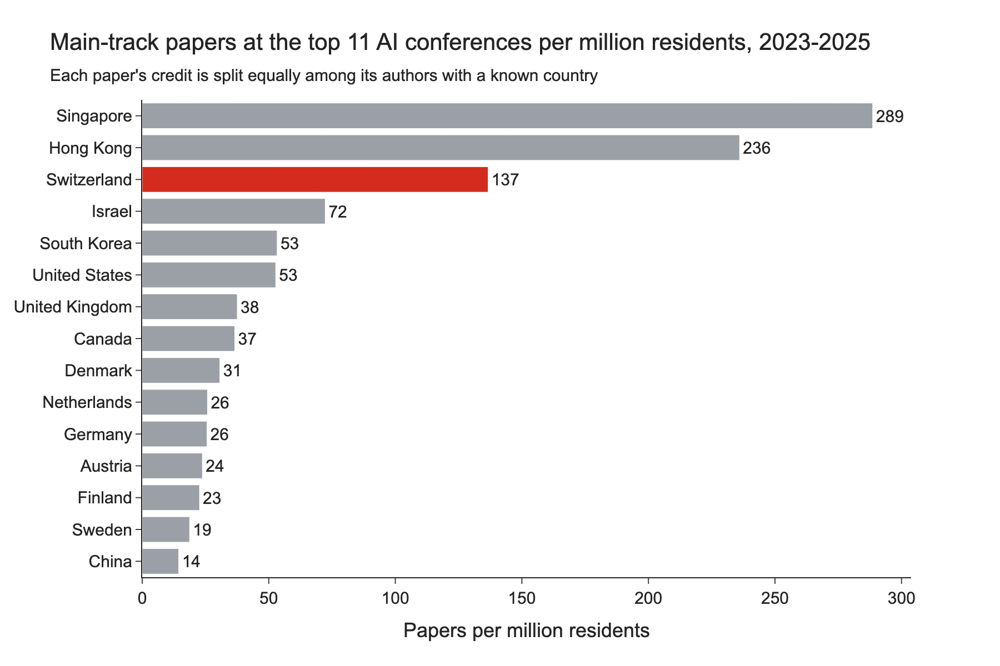
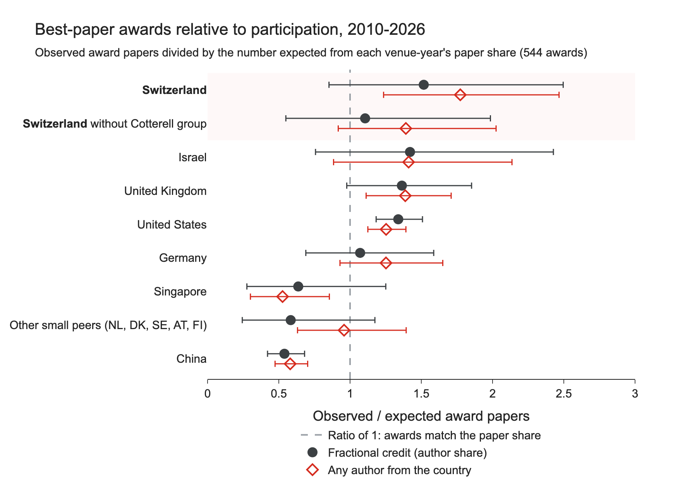
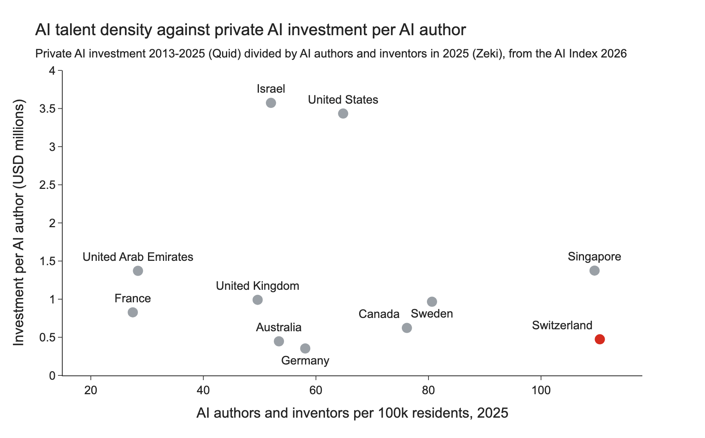
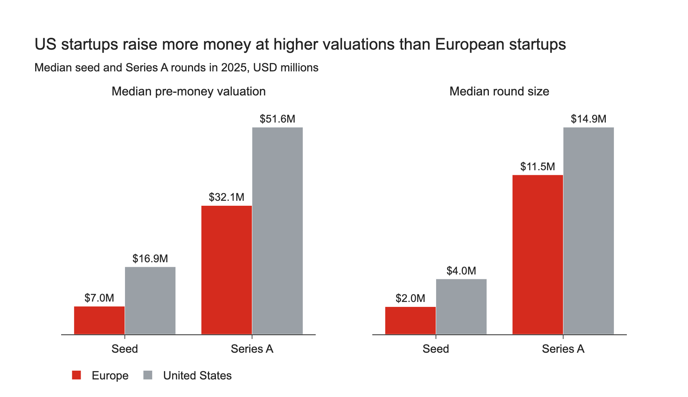
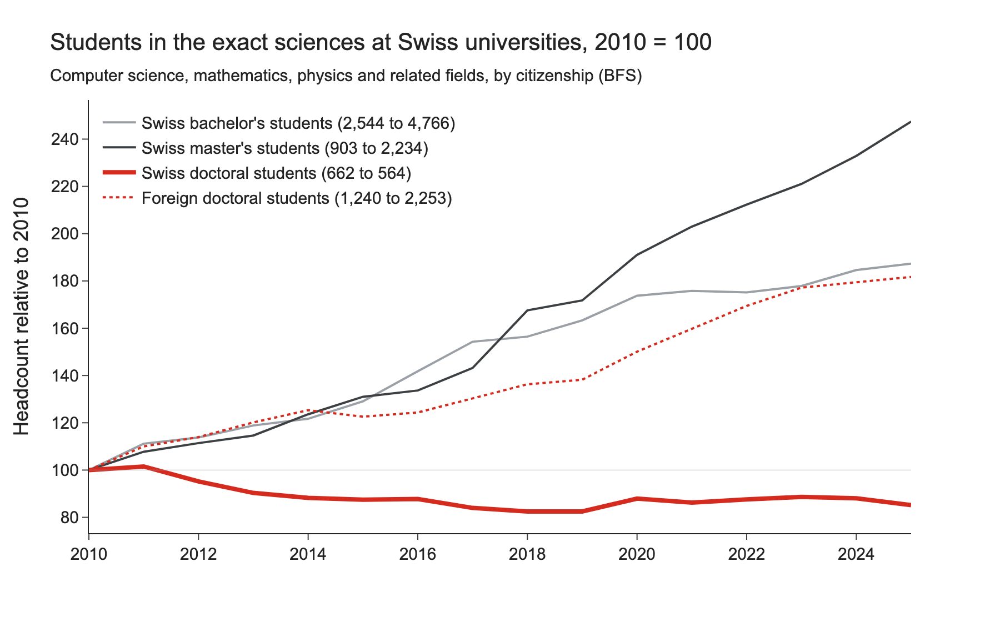

# Switzerland Does Top AI Research, but Too Little of It Stays

**TL;DR:** From 2023 to 2025, Swiss institutions wrote 138 main-track papers per million residents at the top 11 AI conferences. Among places with more than a million residents, only Singapore and Hong Kong wrote more. Less of it turns into Swiss companies and Swiss researchers: Israel attracts 3.6 times as much private AI investment per resident, European startups (Swiss ones included) raise seed rounds at less than half the US valuation, and 34 of 40 documented acquisitions of Swiss AI startups went to foreign buyers. Since 2010, Swiss master's students in the exact sciences have more than doubled, while Swiss doctoral students fell by 15%.

When our FinePhrase paper won an outstanding paper award at COLM 2026, I wondered how many of these awards go to researchers in Switzerland. With federal research cuts coming in 2027, the question grew: how much of Switzerland's AI research turns into Swiss companies and Swiss researchers?

To find out, I collected every main-track paper and best-paper award since 2010 at the top 11 AI conferences (CVPR, ICCV, ECCV, ACL, EMNLP, NAACL, COLM, NeurIPS, ICML, ICLR and AAAI) and compared them with investment, acquisition and enrolment data.

## Swiss AI research is strong per resident

Figure 1 splits each paper's credit equally among its authors with a known country, using OpenReview profiles and OpenAlex affiliations.

<figure>
  
  <figcaption>Figure 1: Main-track papers at the top 11 AI conferences per million residents, 2023 to 2025 (World Bank population, 2024). A paper with two Swiss and two US authors adds 0.5 to each country.</figcaption>
</figure>

Swiss institutions wrote 1,240 of 60,337 main-track papers from 2023 to 2025, or 138 per million residents. Only Singapore (288) and Hong Kong (236) wrote more; Israel (72), the US (53) and Germany (26) wrote far less. Per researcher, Switzerland wrote 23 papers per 1,000 full-time researchers ([OECD MSTI](https://data-explorer.oecd.org/)), behind Singapore (35) but twice the US (10).

Awards are a weaker signal. Figure 2 compares each country's award papers with what its paper share at the same venue and year predicts.

<figure>
  
  <figcaption>Figure 2: Award papers relative to participation, 2010 to 2026 (544 best and outstanding paper awards at the top 11 AI conferences). Filled circles split each award paper among its authors' countries, as in Figure 1; open diamonds count a paper for every country with at least one author. Bars are 95% Poisson intervals. At the dashed line, a country wins exactly as many awards as its paper share predicts.</figcaption>
</figure>

Swiss institutions appear on 35 award papers where their paper share predicts 19.7, a ratio of 1.8 (95% interval 1.2 to 2.5), or 1.5 (0.9 to 2.5) with fractional credit. Ryan Cotterell's group at ETH Zurich has 8 of the 35, and without it both intervals include 1. The US, the UK, Germany and Israel also sit above 1, because China wins far fewer awards than its paper share predicts. The Swiss award record is suggestive rather than established.

European Research Council (ERC) grants show the strength more clearly. In the 2014 to 2020 calls, Swiss institutions hosted 52 grants per million residents, against 35 for Israel and 14 for Germany ([CORDIS](https://cordis.europa.eu/)). After being shut out of most 2021 to 2024 calls ([SERI](https://sbfi.admin.ch/en/funding-for-mono-beneficiary-projects-under-2021-2024-horizon-package)), Swiss hosts won 92 Starting, Consolidator and Advanced Grants in the 2025 calls, more than in any year from 2015 to 2020 ([ERC](https://erc.europa.eu/news-events/news/erc-2025-advanced-grants-results)).

The question is how much of that research turns into Swiss companies.

## Swiss AI startups raise little money and are often sold abroad

In the [AI Index 2026](https://hai.stanford.edu/ai-index), Switzerland has the most AI authors and inventors per capita of the 21 countries in Zeki's data (about 110 per 100,000 residents, tied with Singapore), but Figure 3 shows how little private AI investment each of them attracts.

<figure>
  
  <figcaption>Figure 3: AI authors and inventors per 100,000 residents in 2025 (Zeki) against private AI investment from 2013 to 2025 per AI author (Quid), from the AI Index 2026 public data. Countries without both values are not shown.</figcaption>
</figure>

From 2013 to 2025, Switzerland raised $474,000 of private AI investment per AI author, against $3.57M in Israel and $3.43M in the US. Per resident, Israel raised $1,859, the US $2,227 and Switzerland $523, still ahead of the UK ($492) and Germany ($205). Israel's figures partly reflect defence links and US investors, and Zeki's Swiss count includes researchers at the Zurich offices of US companies.

Company formation is not the bottleneck: in 2025, ETH Zurich recognised 46 new ventures and EPFL launched a record 39 startups ([ETH](https://ethz.ch/en/news-and-events/eth-news/news/2026/02/mm-more-new-companies-founded-new-regulations-new-accelerator.html), [Startupticker](https://www.startupticker.ch/en/news/epfl-startups-celebrate-record-2025)). The growth money mostly comes from abroad: since 2015, Swiss investors supplied 21% of the capital raised by Swiss scale-ups and US investors 36% ([Swiss Startup Radar 2025/26](https://www.startupticker.ch/assets/files/StartupRadar25_26.pdf)).

European investors also pay less per round. Figure 4 compares the median seed and Series A rounds in Europe (including Switzerland) and the US in 2025, from Atomico's [State of European Tech 2025](https://www.stateofeuropeantech.com/chapters/investment-levels).

<figure>
  
  <figcaption>Figure 4: Median pre-money valuation and median round size of seed and Series A rounds in Europe and the US, January to September 2025 (Atomico, from Dealroom data without biotech). Atomico gives the US round size as a ratio to the European one; the bars convert it to dollars.</figcaption>
</figure>

The median European seed round raised half as much as the US one, at less than half the valuation ($7.0M against $16.9M). Dividing each median round by its post-money valuation, European founders sell roughly 22% of their company at seed and 26% at Series A, against 19% and 22% in the US (an estimate, since the two medians come from different rounds). The gap does not come from the best-known funds: rounds led by the 130 established European investors that Atomico tracks are larger than the US median.

The companies themselves often end up abroad. Of the 40 acquisitions of Swiss AI startups since 2010 that I could document, 34 went to foreign buyers and 22 to US companies, from Apple buying Faceshift in 2015 to Amazon buying RIVR in 2026. Three of the 28 best-funded AI startups founded in Switzerland have moved their headquarters to the US (Auterion, Cyberhaven and Browser Use). The founders are not the missing piece: the commercial register shows 42 of the 76 with a known citizenship to be Swiss. Much of the remaining transfer happens inside US companies: Google has long done research in Zurich, and OpenAI and Anthropic opened research offices there in late 2024 and early 2025 ([WSJ](https://www.wsj.com/tech/ai/openai-expands-in-europe-with-zurich-office-f3425003), [Greater Zurich Area](https://www.greaterzuricharea.com/en/news/anthropic-appoints-leading-ai-researcher-neil-houlsby-lead-their-zurich-office)).

Swiss universities show the same pattern in who does the research.

## Fewer Swiss students go on to a doctorate

The Federal Statistical Office (BFS) does not publish computer science by degree level and citizenship, so Figure 5 uses the exact sciences (computer science is about half).

<figure>
  
  <figcaption>Figure 5: Students in the exact sciences at Swiss universities by level and citizenship, indexed to 2010 (BFS). The legend gives the headcounts in 2010 and 2025. Dual citizens count as Swiss.</figcaption>
</figure>

From 2010 to 2025, Swiss master's students in these fields grew from 903 to 2,234, while Swiss doctoral students fell from 662 to 564 and foreign ones grew from 1,240 to 2,253. Swiss citizens are 36% of master's students but 20% of doctoral students. The OECD counts 84% of ICT doctoral students in Switzerland as having moved there to study, against 53% in the UK and 32% in Germany ([OECD](https://data-explorer.oecd.org/), 2024). The same holds further up: Swiss citizens are 35% of professors at ETH Zurich and 29% at EPFL ([BFS](https://www.bfs.admin.ch/asset/de/36685357), 2025).

The Swiss citizens who do go into research win awards at about the rate their population predicts. Since 2010, 7 confirmed Swiss citizens (11 with probable ones) are among 2,490 award winners, where Switzerland's share of the population of OECD countries and China predicts 6.6 (world population: 2.2; world researchers, including foreigners working in Switzerland: 14.9). The institutions' award record rests largely on researchers who came from elsewhere.

## What Switzerland should do

These are my opinions. First, keep funding the research. It is sad to see the federal budget for the Swiss National Science Foundation and Innosuisse cut by 5% from 2027, about CHF 68M and CHF 17M a year ([parliament](https://www.parlament.ch/de/services/news/Seiten/2026/20260304182645577194158159026_bsd185.aspx)).

Second, help Swiss startups raise their growth rounds at home. Swiss pension funds manage about CHF 1,100B, yet venture capital was 0.02% of their assets in 2023 ([investrends](https://investrends.ch/aktuell/news/zwei-prozent-pflicht-brussel-will-pensionskassen-ins-risikokapital-treiben-und-die-schweiz-schaut-zu/)). Missing return data is no longer a good reason: a December 2025 study of 18 Swiss venture firms found returns on par with the European benchmark, 14% a year for the 2014 to 2020 funds, though mostly on paper so far ([Deep Tech Nation](https://deeptechnation.ch/dtn-news/the-evidence-we-needed-establishing-the-first-benchmark-for-swiss-vc-return/)).

Third, Swiss companies should be the first customers, investors and buyers of Swiss AI startups; Swiss buyers made only 6 of the 40 acquisitions above. A founder whose customers, investors and eventual buyer are Swiss has less reason to move to San Francisco.

Fourth, bring more Swiss master's students into machine learning doctorates, for example through industry PhD tracks with the Zurich labs.

Switzerland already pays for the research. It should keep more of what the research produces.

The code is on [GitHub](https://github.com/JoelNiklaus/swiss-ai-research) and the data, including the hand-collected award, acquisition and founder tables with their sources, is on the [Hugging Face Hub](https://huggingface.co/datasets/joelniklaus/swiss-ai-research). Thanks to Andrés Marafioti for useful feedback, and to the teams behind OpenAlex, OpenReview, DBLP, Paper Copilot and the AI Index for their open data.

## Limitations

OpenAlex maps a plain "Google Research" affiliation to the US; I reassign it when the raw affiliation names a Swiss city, but some Zurich authors still count as American. For ICLR, ICML and NeurIPS 2023 to 2025, my pipeline counts 19% more Swiss papers than [Paper Copilot](https://github.com/papercopilot/paperlists)'s independent affiliation data, a gap similar to Israel (25%) and Canada (17%), so the ranking holds but the counts carry that uncertainty. AAAI counts include its applied and educational tracks (about 10% extra papers). The citizen counts are lower bounds and the acquisition list misses unannounced deals. The valuation data covers all European startups except biotech; Atomico finds European AI startups valued about 20% above others at seed and Series A, so the gap for AI startups may be smaller.
